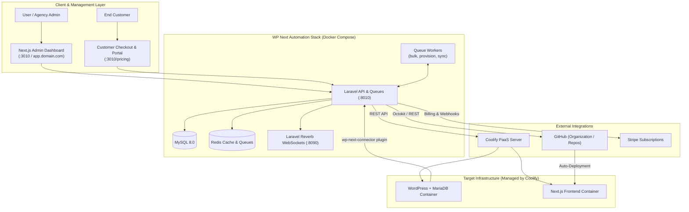

<div align="center">

# WP Next Automation

### ⚡ The Open-Source Self-Hosted Control Plane for Headless WordPress & Next.js on Coolify

Automate decoupled WordPress + Next.js provisioning on your own servers with zero vendor lock-in, automated GitHub repo creation, real-time sync, and optional Stripe subscription billing.

[](https://github.com/boom-devs/wp-next-automation/actions/workflows/ci.yml)
[](https://opensource.org/licenses/MIT)
[](https://www.docker.com/)
[](https://coolify.io)
[](https://wordpress.org)
[](https://nextjs.org)

<p align="center">
  <a href="#-about--value-proposition">About</a> •
  <a href="#%EF%B8%8F-why-wp-next-automation-comparison">Why WP Next Automation?</a> •
  <a href="#%EF%B8%8F-system-architecture">Architecture</a> •
  <a href="#-quick-start">Quick Start</a> •
  <a href="#-components">Components</a> •
  <a href="#-integrations-guide">Integrations</a> •
  <a href="#-contributing">Contributing</a> •
  <a href="#-maintainers--credits">Maintainers</a> •
  <a href="#-license">License</a>
</p>

</div>

---

## 📖 About & Value Proposition

**WP Next Automation** is an enterprise-grade, open-source control plane engineered for developers, agencies, and SaaS founders who want the ultimate headless WordPress architecture—without paying expensive monthly fees to proprietary hosting platforms like WP Engine Atlas, Vercel Enterprise, or Kinsta.

By marrying **WordPress** as a headless CMS, **Next.js** for frontend rendering, and **Coolify** as your self-hosted PaaS, WP Next Automation gives you:

- 🚀 **1-Click Site Provisioning:** Automated container deployment of WordPress + MariaDB + Next.js on Coolify.
- 🔄 **Real-Time Content Sync:** WordPress webhook triggers automated GitHub code updates and instant Coolify redeploys.
- 📦 **Automated GitHub Repository Setup:** Automatic creation of private or public Next.js repositories under your GitHub organization.
- 💳 **Built-in Multi-Tenancy & Stripe SaaS:** Ready-to-use customer portal, subscription plan management, and checkout flows.
- 🔒 **Zero Vendor Lock-in:** 100% self-hosted on your own VPS (Hetzner, DigitalOcean, AWS, OVH, or bare-metal).

---

## ⚖️ Why WP Next Automation? (Comparison)

| Feature | WP Next Automation | Traditional Monolithic WP | Manual Headless (WP + Vercel) | Proprietary Headless SaaS |
| :--- | :--- | :--- | :--- | :--- |
| **Hosting Cost** | 🟢 **Fixed VPS Cost ($5–$20/mo)** | 🟢 Low | 🔴 High ($20/mo/user + bandwidth) | 🔴 Extremely Expensive ($150–$500+/mo) |
| **Data Ownership** | ✅ **100% On your own servers** | ✅ Self-hosted | ⚠️ Split across vendors | ❌ Locked into proprietary cloud |
| **Site Provisioning** | ✅ **Automated 1-Click Control Plane** | ⚠️ Manual install / scripts | ❌ Manual multi-step configuration | ✅ Automated |
| **Sync Engine** | ✅ **Instant WP ➔ Next.js Git Sync** | ❌ N/A | ⚠️ Complex custom webhooks | ✅ Automated |
| **Infrastructure** | ✅ **Coolify PaaS (Self-hosted)** | ❌ Traditional cPanel / LEMP | ⚠️ Proprietary Serverless | ❌ Closed proprietary infra |
| **SaaS Billing Ready**| ✅ **Stripe Plans & Portal included** | ❌ Requires custom plugins | ❌ Custom engineering needed | ⚠️ Extra cost add-on |
| **Licensing** | ✅ **100% Open-Source (MIT)** | ⚠️ Mixed | ⚠️ Vendor lock-in | ❌ Proprietary closed source |

---

## 🏗️ System Architecture

WP Next Automation orchestrates the entire lifecycle from customer registration to WordPress content sync:



---

## 🚀 Quick Start

### 1. Interactive Installer (Linux VPS — Ubuntu 22.04 / 24.04 Recommended)

SSH into your clean VPS and run the interactive installer:

```bash
curl -fsSL https://raw.githubusercontent.com/boom-devs/wp-next-automation/main/install.sh -o install.sh
chmod +x install.sh
sudo ./install.sh
```

> [!NOTE]
> Do **not** pipe directly into bash (`curl | bash`), as the installer requires an interactive TTY terminal to configure your installation safely.

The wizard will guide you through:
1. **Target Installation Directory** (Default: `/opt/wp-next-automation`)
2. **API URL (`APP_URL`)** (e.g. `https://api.yourdomain.com`)
3. **Dashboard URL (`FRONTEND_URL`)** (e.g. `https://app.yourdomain.com`)
4. **Superadmin Email & Secure Password**

All cryptographically secure keys (`APP_KEY`, `JWT_SECRET`, database credentials, and Reverb tokens) are generated automatically.

### 2. Local Development (macOS with Docker Desktop)

```bash
# Clone the repository
git clone https://github.com/boom-devs/wp-next-automation.git
cd wp-next-automation

# Copy and configure environment
cp .env.template .env

# Run non-sudo installer
./install.sh
```

---

## 🧩 Components

| Component | Technology | Role & Purpose |
| :--- | :--- | :--- |
| **Orchestrator** | Shell (`install.sh`), Make, Docker Compose | Interactive installer, health checks, secrets generation, and reverse proxy setup. |
| **Backend Portal** | Laravel 12, Octane, Queue Workers | Core REST API, Coolify orchestrator, GitHub synchronizer, and Stripe cashier. |
| **Dashboard** | Next.js 14/15, Tailwind CSS | Modern administrative SPA for managing sites, integrations, users, and plans. |
| **Connector** | WordPress Plugin (`wp-next-connector`) | Installed automatically on client WordPress sites to handle sync webhooks and tokens. |
| **Realtime Engine**| Laravel Reverb | High-performance WebSocket server for live site provisioning and sync progress. |
| **Database & Cache**| MySQL 8.0 & Redis Alpine | Encrypted platform settings, tenant records, and background queue handling. |

---

## 🔌 Integrations Guide

Once the installer finishes and you log in to the dashboard at `FRONTEND_URL`:

### 1. Coolify Setup
- Navigate to **Admin ➔ Integrations ➔ Coolify**.
- Provide your Coolify API URL and Bearer Token (generated under **Coolify ➔ Keys & Tokens**).
- Configure your Server UUID, Project UUID, and Environment (typically `production`).
- Click **Save & Test Coolify Connection**.

### 2. GitHub Integration
- Navigate to **Admin ➔ Integrations ➔ GitHub**.
- Connect your GitHub OAuth App or Personal Access Token (PAT) with `repo` scope.
- Define your GitHub Organization or Personal Username where Next.js repos will be created.
- Configure `AWN_PLUGIN_GITHUB_REPO` to point to the connector plugin repository.

### 3. Stripe & Billing (Optional)
- Configure your Publishable Key, Secret Key, and Webhook Secret (`{APP_URL}/api/stripe/webhook`).
- Create and map subscription tiers (Free, Starter, Agency) directly to site quotas.

### 4. SMTP / Transactional Email
- Set your SMTP credentials under **Admin ➔ Integrations ➔ Mail** to ensure WordPress login details and reset emails reach users safely.

---

## 🛠️ Useful Commands

```bash
# Check service health
docker compose ps

# Inspect live logs
docker compose logs -f portal worker

# Restart core services
docker compose restart portal worker dashboard

# Run Laravel Artisan tinker inside the portal
docker compose exec portal php artisan tinker

# Validate configuration & ShellCheck
make lint
```

---

## 🛡️ Security & Zero-Trust Architecture

- **Encrypted Platform Settings:** External API tokens (Coolify tokens, GitHub PATs, Stripe secrets) are encrypted at rest in the database using Laravel's AES-256-CBC cipher.
- **Strict Network Isolation:** MySQL and Redis ports are bound exclusively to the private Docker bridge network—never exposed to the public Internet.
- **Isolated Site Sandboxing:** Each provisioned WordPress site runs in an isolated Coolify project with dedicated container boundaries.

---

## 👥 Contributing

We welcome contributions from the open-source community!

1. Fork the repository.
2. Create your feature branch (`git checkout -b feature/amazing-feature`).
3. Validate your changes:
   ```bash
   make lint
   ```
4. Commit your changes with conventional commit messages (`git commit -m 'feat: add support for custom traefik domains'`).
5. Push to your branch (`git push origin feature/amazing-feature`).
6. Open a Pull Request.

Please see our [CONTRIBUTING.md](CONTRIBUTING.md) and [CODE_OF_CONDUCT.md](CODE_OF_CONDUCT.md) for details.

---

## 👨‍💻 Maintainers & Credits

**WP Next Automation** is maintained with ❤️ by **[BoomDevs](https://github.com/boom-devs)** and open-source contributors:

- **[Md. Noruzzaman](https://github.com/noruzzamans)** — WordPress Core & Gutenberg Engineer | WordPress 7.2 Release Squad (Test Lead)
- **[Md. Enamul Haq](https://github.com/EnamulHaq)** — Backend Architect & Core Systems Engineer

### Special Thanks
- [Coolify](https://coolify.io) — The fantastic open-source self-hostable Heroku/Netlify alternative.
- [WordPress](https://wordpress.org) — The world's open web CMS.
- [Next.js](https://nextjs.org) — The React framework for the Web.

---

## 📄 License

This project is open-source software licensed under the **[MIT License](LICENSE)**.
