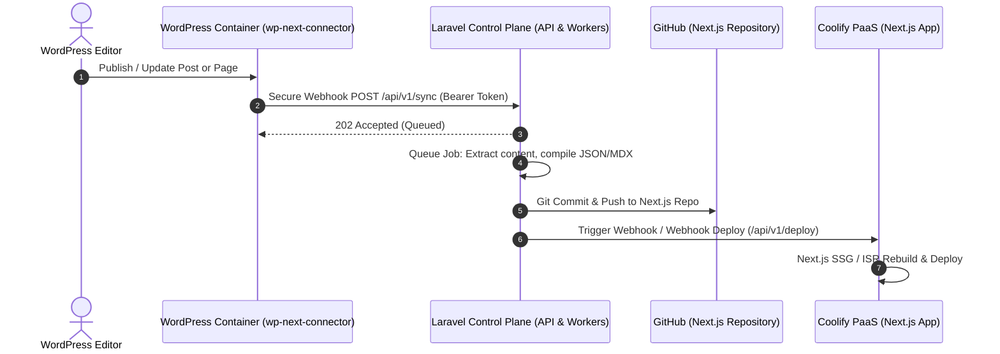

# WordPress Connector Plugin Guide (`wp-next-connector`)

This guide explains the architecture, automated provisioning, and manual pairing procedures for the **WP Next Connector** WordPress plugin.

---

## 📖 Overview

The **WP Next Connector** plugin is a lightweight WordPress extension deployed on each provisioned WordPress container. It acts as the bridge between the WordPress content editor and the **WP Next Automation** control plane.



---

## 📦 Distribution Strategy

### 1. Automated Provisioning (Default)

During the **Sites ➔ Add site** workflow, the control plane automatically downloads the connector ZIP file from GitHub using the configuration set under **Admin ➔ Integrations ➔ GitHub**:

```env
AWN_PLUGIN_GITHUB_REPO=boom-devs/wp-next-connector
AWN_PLUGIN_GITHUB_REF=main
```

- **For Open-Source / Public Repositories (Recommended):**  
  Point to a public repository (e.g. `boom-devs/wp-next-connector`). The portal downloads the release asset directly without requiring authentication.
- **For Private Forks:**  
  If hosting a custom proprietary fork of the connector, ensure the GitHub Personal Access Token (PAT) configured in **Admin ➔ Integrations ➔ GitHub** has `repo` read access.

---

## 🛠️ Manual Installation & Pairing (Fallback)

If automated provisioning fails (e.g. GitHub API rate limits, network restrictions, or self-signed VPS certificates), you can manually install and pair the connector in under 2 minutes:

### Step 1: Download the Connector ZIP
Download the latest release ZIP from the official repository releases:
```bash
curl -fsSL https://github.com/boom-devs/wp-next-connector/releases/latest/download/wp-next-connector.zip -o wp-next-connector.zip
```

### Step 2: Upload to WordPress
1. Log in to your WordPress Admin dashboard (`https://site.yourdomain.com/wp-admin`).
2. Navigate to **Plugins ➔ Add New Plugin ➔ Upload Plugin**.
3. Choose `wp-next-connector.zip` and click **Install Now**.
4. Click **Activate Plugin**.

### Step 3: Pair the API Sync Token
1. Open the **WP Next Automation Dashboard** ➔ **Sites** ➔ Click on your site.
2. Copy the **Sync Secret Token** (`awn_api_token`).
3. In WordPress Admin, navigate to **Settings ➔ WP Next Connector**.
4. Paste the token into the **API Sync Token** field and set the **Control Plane API URL** (`APP_URL`).
5. Click **Save & Test Connection**.

---

## 🔍 Troubleshooting & Common Issues

| Issue | Root Cause | Resolution |
| :--- | :--- | :--- |
| **`404 Not Found` on `/wp-json/awn/v1/sync`** | WordPress permalinks are set to Plain. | In WP Admin, go to **Settings ➔ Permalinks** and select **Post name** (`/%postname%/`). |
| **`401 Unauthorized` during Sync** | Mismatch between site token and portal record. | Copy the sync token from the dashboard and re-save in plugin settings. |
| **`cURL 28: Connection timed out`** | Firewall or Docker network blocking container-to-container calls. | Ensure the WordPress container can resolve and reach `APP_URL`. |
| **Cloudflare `403 Forbidden` on Webhook** | Cloudflare WAF / Bot Fight Mode blocking automated POST requests. | Add a Cloudflare WAF skip rule for `/wp-json/awn/*` and `/api/stripe/webhook`. |
